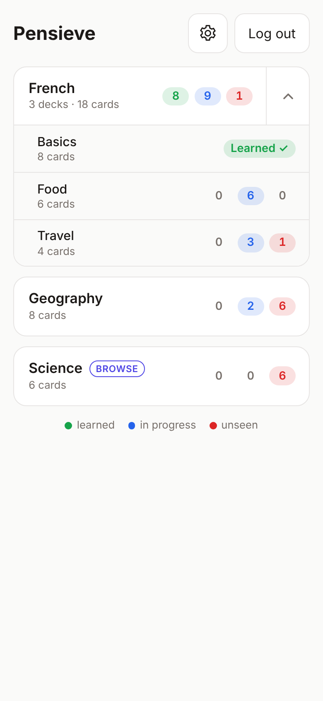
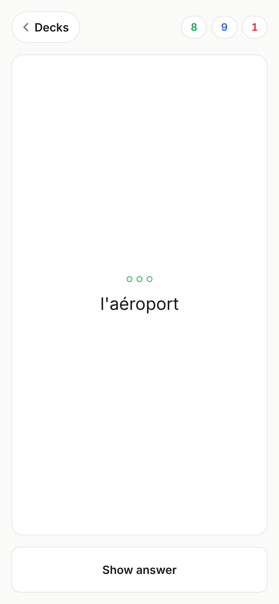
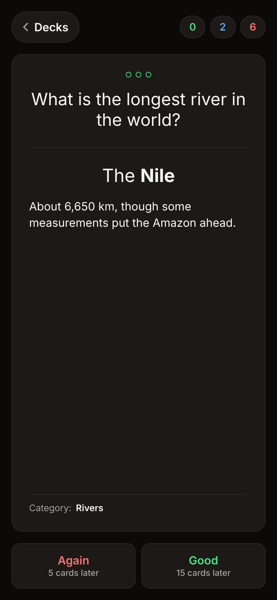
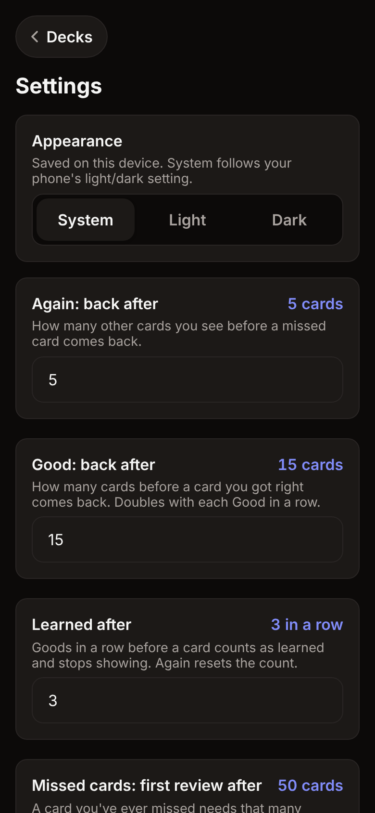
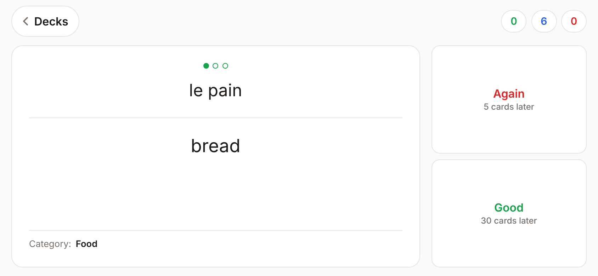

# Pensieve

A small, fast flashcard app for your phone. There are no daily limits and only two buttons. Cards come
back after a set number of other cards rather than after a number of days, so you can study as much as
you like in one sitting.

Built with Next.js (App Router) and Postgres (Neon, via drizzle). It sits behind a single passcode and
installs as an app on Android and iOS.

<p align="center">
  
  
  
  
</p>
<p align="center">
  
</p>

## Features

- **Two answers, Again or Good.** Three Goods in a row and a card is learned and stops coming up.
- **Count-based spacing.** No due dates and no "come back tomorrow". A card returns after N other cards.
- **Missed cards get reviewed.** A card you ever got wrong needs three extra, widely spaced Goods
  before it counts as learned.
- **Decks and sub-decks.** Study one sub-deck or the whole deck. The counters show
  🟢 learned · 🔵 in progress · 🔴 unseen.
- **Streak dots** on every card show how far along it is. Review dots are drawn apart, in blue.
- **Rich cards.** Markdown, images, video and audio (external URLs), plus notes, an explanation and
  extra info lines that appear once the answer is shown.
- **Browse decks.** Go through cards in random order with **Next**, and send the ones you miss into
  the Again/Good loop.
- **Hands-free voice mode.** Say your answer and it's checked against the card (✓/✗), then counted
  as Good or Again after 3 seconds unless you say "right" or "wrong". Optionally reads each card aloud.
- **Phone first.** Installable PWA, light and dark themes, landscape layout, and the next card is
  prefetched so answers feel instant.
- **Import anything.** A JSON import API that updates content without ever resetting progress, plus
  an Anki `.apkg` converter.

## How studying works

Each deck keeps a count of answers given in it (a deck and its sub-decks share one count). When you
answer, the card is scheduled to return a set number of answers later:

| Answer | What happens |
|---|---|
| **Again** | Comes back after 5 cards. Its Good streak resets to 0. |
| **Good** (1st, 2nd) | Comes back after 15 cards, then 30. The gap doubles each time. |
| **Good** (3rd in a row) | **Learned**. It isn't shown again. |

**Missed cards.** A card answered Again at any point isn't learned after those 3 Goods. It first needs
3 more Goods in a row, after 50, 100 and then 200 cards. Again during that review stage keeps it in
review (back after 50 cards) and the review Goods start over.

**Which card comes next:**

1. A card whose turn has come, the longest-waiting first.
2. Otherwise the next new card. SRS decks use import order; browse decks are random.
3. Otherwise the next card in progress, shown early.

When several cards come due at once, every third card is a new one, so a batch of reviews doesn't
arrive as one long run. All the gaps can be changed in Settings.

**Browse decks** show unseen cards in random order. **Next** only marks a card seen, and **Again**
puts it into the loop above.

## Setup (Vercel CLI, no Git integration)

```bash
npm i -g vercel@latest
vercel login
vercel link                      # create project "pensieve"; don't connect a Git repo
vercel integration add neon      # Marketplace Neon DB → injects DATABASE_URL
vercel env add APP_PASSCODE production   # repeat for preview / development
vercel env pull .env.local

npm install
npm run db:migrate               # apply ./drizzle migrations
npm run seed                     # 20 demo cards (idempotent)
npm run dev
vercel --prod                    # deploy
```

### Migrations on deploy

Vercel runs the `vercel-build` script, which applies any pending migrations in `./drizzle`
(`npm run db:deploy`) and then runs `next build`, so a fresh Neon database gets its tables on the
first deploy. Only production deploys do this: preview builds (one per pull request) share the
same database, so they skip migrations and a schema change lands only when it is merged. Set `SEED_DEMO=1` to also load the 20 demo cards (CI does this for the end-to-end tests). If `DATABASE_URL_UNPOOLED` is set it is used for migrations.

The app connects with node-postgres (`pg`) everywhere: Neon, local Postgres and CI use the same driver.

## Voice

Tap the 🎤 button on the study screen to cycle **Off → Voice answers → Read aloud + voice answers**
(remembered on the device). The screen stays on while voice is on. Each card gets 2 seconds to be
read before listening starts. It starts listening with each card and again after
each thing you say. Chrome on Android stops listening after a few seconds of silence and dings every
time it starts, so after a silence it waits for a tap on **Tap to listen** rather than dinging again.

| When | Say | Does |
|---|---|---|
| Question showing | *your answer* | Checks it, reveals the card with ✓ or ✗, and counts Good or Again after 3 seconds |
| | "show" / "answer" | Reveals without checking (when you don't know) |
| ✓ / ✗ showing | "right" / "wrong" | Overrules the check and answers straight away |
| Answer showing | "good" / "yes", "again" / "no" | Answers |
| Any time | "repeat", "more", "stop" | Reads the card again, reads the notes and explanation, turns voice off |

An answer is right when it contains the **bold** part of the card's answer (with "or" or "/", the bold part
of either side on its own), or else any one of its meanings (split by `,` `;` `/`, "or" or lines), or anything after "Accept:" in the notes. Case, accents,
punctuation, "the/a/to" and small misspellings are ignored. Answers are heard in English, so foreign
names are matched the way English spells them: "Godel" or "Goedel" for "Gödel", "Strauss" for
"Strauß", and sound-alikes such as "Filip" for "Philippe". Short words must match exactly, so near
neighbours (Iran/Iraq, Austria/Australia) stay wrong.

Read aloud reads the question in the deck's language: from the script for non-Latin text, otherwise
from the top-level deck's name ("Swedish" → Swedish), and it can be changed per deck. Answers are read
in English, skipping pinyin; after a right spoken answer it just says "Correct.". You can talk over it
at any time: the mic stays on while it reads, and what it hears of its own voice is ignored.

**Your accent** (Settings: US / UK / India) sets the English both engines listen for, so an Indian or
British accent is understood better.

**Recognition engines** (Settings → Voice recognition, saved per device):

- **Browser**: Chrome's built-in Web Speech API. Free, but on Android it dings and shows the mic
  notification every time it starts listening, and it stops after a few seconds of silence.
- **Gemini**: the app keeps the microphone open, cuts the audio into utterances when you pause
  (`src/lib/audio.ts`), and `POST /api/transcribe` sends each clip (16 kHz WAV) to
  [Gemini 3.5 Transcribe](https://ai.google.dev/gemini-api/docs/transcribe) in verbatim mode with
  your English accent and the deck's language as hints and the command words as vocabulary, not
  stored by Google. No dings, better with names and
  other languages. Needs `GEMINI_API_KEY` in the app's environment (Vercel → Settings → Environment
  Variables); without it the option is greyed out.

The logic is in `src/lib/voice.ts`.

## Install on a phone

Pensieve is an installable web app (PWA). On Android, open it in Chrome and tap **Install app** in
Settings, or use Chrome's **⋮ → Add to Home screen**. On iOS, use Safari's **Share → Add to Home
Screen**. It then opens full screen from its own icon, rotates to landscape, and stays logged in (the
session lasts a year). The manifest (`src/app/manifest.ts`) and the icons (`public/`, drawn from
`public/icon.svg`) are served without the passcode so the browser can read them.

## API

Every route requires the session cookie or `Authorization: Bearer $APP_PASSCODE`, except `/login` and `/api/login`.

| Route | |
|---|---|
| `POST /api/login` `{passcode}` | sets the httpOnly session cookie |
| `GET /api/decks` | decks with `learning`, `new` (never seen), `learned` and `total` card counts |
| `GET /api/next?deck=&category=&season=&exclude=` | next card (see above) plus `outcomes`: what Again and Good would do. `exclude` skips one card id; the study screen uses it to prefetch the next card |
| `POST /api/review` `{card_id, answer: "again" \| "good"}` | updates `card_state` and appends `review_log` (browse: Good on a card not being learned only marks it seen) |
| `POST /api/review` `{card_id, action: "bookmark", value}` | bookmark toggle |
| `POST /api/import` `[cards]` or `{decks, cards}` | upserts by id and never touches progress; max 5000 cards per request |
| `POST /api/transcribe` `{audio, mime_type, languages?}` | speech to text with Gemini (needs `GEMINI_API_KEY`); returns `{text}` |
| `GET` / `PATCH /api/settings` (UI at `/settings`) | `again_gap` (5), `good_gap` (15), `learned_after` (3), `review_gap` (50) |

Card shape: `{id, deck, front, back, tags?, category?, media?: [{type: image|video|audio, url, side: front|back}], meta?: {season?, ...}}`.

Deck shape: `{id, name?, kind?: srs|browse, parent?}`. Sub-decks are one level deep: `parent` must be a
top-level deck, and a sub-deck always has its parent's `kind` (omit it to inherit). Studying a parent
draws from its own cards and all its sub-decks, and its counts include theirs.
Media are external URLs only. Card text (`front`, `back`) is **Markdown** (bold, italics, lists, links;
raw HTML is never rendered). Optional extras in `meta` enrich the back of a card: `notes` (marking
guidance, shown small under the answer), `explanation`, and `info` (`[{label, value}]` lines in the
footer, shown with the category). `meta.raw` can hold the untouched source record; it is stored but
never sent to the browser. `tags` are shown under the question.

## Importing cards

Send decks and cards to `POST /api/import` (see the shapes above). Ids are stable, so re-importing
updates content and never resets progress.

Raw source material belongs in `content/`, which is gitignored and never committed. One-off converters
live in `scripts/` and write a dry-run preview before anything is uploaded.

### From Anki

```bash
npm run anki:inspect -- ~/Downloads/MyDecks.apkg            # describe the export: decks, note types, fields
npm run anki:convert -- ~/Downloads/MyDecks.apkg            # dry run → content/anki/cards.json, cards-preview.csv
npm run anki:convert -- ~/Downloads/MyDecks.apkg --upload   # import (passcode from APP_PASSCODE or --passcode)
```

Export from Anki with **File → Export…** as an *Anki Deck Package (.apkg)* or *Collection Package
(.colpkg)*. Both the current format and "Support older Anki versions" are read. Decks named
`<Subject> - <Level>::<Topic>` become one deck per subject with a sub-deck per level, and the topic
becomes the card's category. Fields are converted from HTML to text and duplicate words are merged into
one card. Everything starts unseen.

## Development

```bash
npm run lint && npm run typecheck && npm test   # unit + integration tests (in-memory PGlite, real migrations)
npm run test:e2e                                # Playwright; needs a migrated + seeded DATABASE_URL and APP_PASSCODE
npm run db:generate                             # after editing src/db/schema.ts
```

CI (`.github/workflows/ci.yml`) runs lint, typecheck, a migration drift check, tests and the build, plus an
end-to-end job against Postgres 16 with Playwright.
